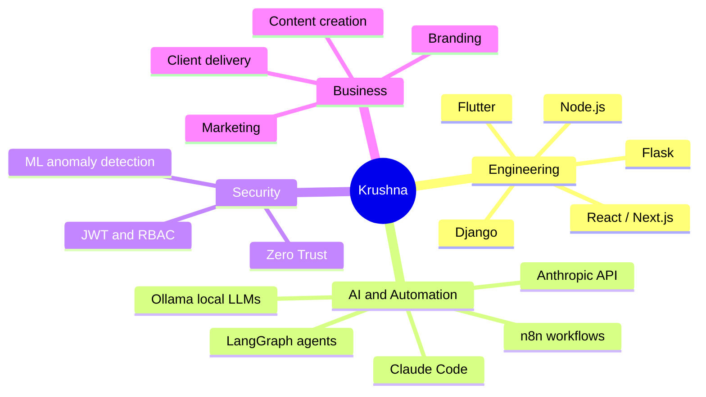
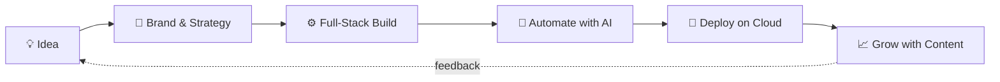

<!-- ═══════════════ HEADER ═══════════════ -->
<div align="center">


<a href="https://github.com/KLI888">
  
</a>

<br/>


[](https://superiors.in)

</div>

---

## `> whoami`

```python
class Krushna:
    handle   = "KLI888"
    base     = "Pune, Maharashtra, India 🇮🇳"
    roles    = ["Founder @ Superiors Technology", "Final-year B.Tech (AI & Data Science)"]
    since    = 2019                      # shipping for clients since day one
    clients  = "20+ across hospitality, healthcare & F&B"
    languages = ["English", "Hindi", "Marathi"]

    superpower = "Code + Brand + Automation under one roof"
    currently  = ["Zero Trust healthcare security", "Local LLMs", "AI agents"]

    def pitch(self):
        return "Most devs can't market. Most marketers can't code. I do both."
```

---

## ⚡ The Rare Combo

Plenty of developers can build. Plenty of people can run branding and marketing. **Very few do both, run a real agency, *and* build AI and security systems.**



---

## 🧰 Arsenal

### 🖥️ Build
<p>

</p>

### 🤖 AI · Agents · Automation
<p>


</p>

### ☁️ Data · Cloud · Tools
<p>

</p>

---

## 🚀 Featured Missions

| 🛰️ Project | 🔥 What it is | ⚙️ Stack |
|---|---|---|
| **Cyber-Pulse** | ML-driven Zero Trust security platform for healthcare information systems — anomaly detection with a human-in-the-loop admin review | Flask · React · Isolation Forest · JWT/RBAC |
| **Jalgaon.com** | Local business directory built for Jalgaon | React · Django |
| **GameRound** | Real-time WebSocket game-round system | Django · React |
| **Shorts Maker** | Free pipeline that turns long YouTube videos into short clips | Python · Automation |
| **Voice Prompt Designer** | Chrome extension that turns voice into polished prompts using on-device AI | JavaScript · Local AI |
| **Missed-Call WhatsApp Bot** | Auto-replies on WhatsApp the moment a call goes unanswered | Android · Automation |

<!-- TODO: add repo links to each project name -->

---

## 🔁 How I Ship



---

## 📊 Stats

<div align="center">


<br/>


</div>

### 🐍 Contribution Snake

<div align="center">
<picture>
  <source media="(prefers-color-scheme: dark)" srcset="https://raw.githubusercontent.com/KLI888/KLI888/output/github-snake-dark.svg" />
  <source media="(prefers-color-scheme: light)" srcset="https://raw.githubusercontent.com/KLI888/KLI888/output/github-snake.svg" />
  
</picture>
</div>

### 📈 Activity Graph

<div align="center">

</div>

---

## 💬 Ask Me About

- 🏢 Building and running a tech and branding agency while still a student
- 🤖 Automating real business workflows with **n8n** and AI agents
- 🧠 Running **local LLMs** with Ollama, without sending data to the cloud
- 🛡️ Applying **Zero Trust** thinking to healthcare systems
- 🎬 Using code to scale content creation

---

## 🤝 Let's Build Something

<div align="center">

[](https://superiors.in)
[](https://github.com/KLI888)
<!-- Add your LinkedIn: [](YOUR_LINK) -->

<br/>

> *"Don't just write code. Build systems that run businesses."*


</div>
