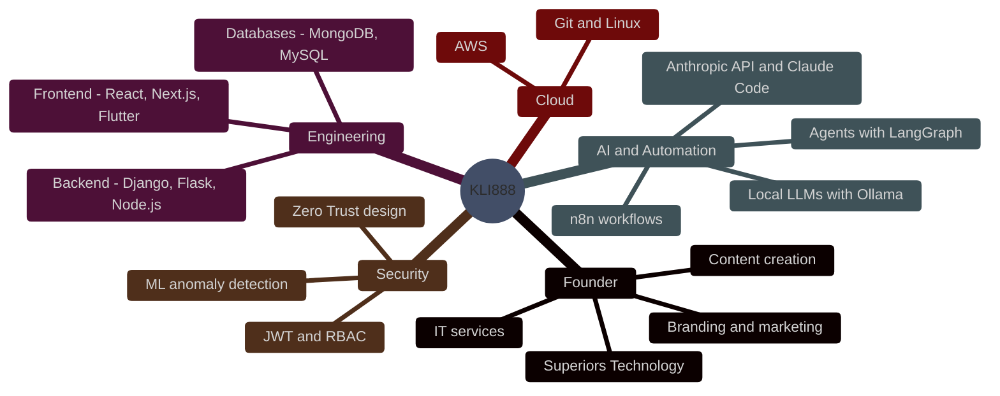
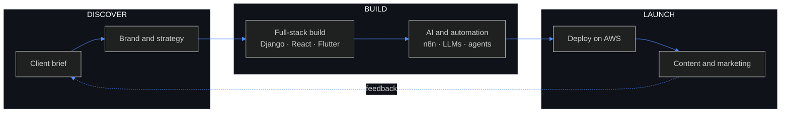
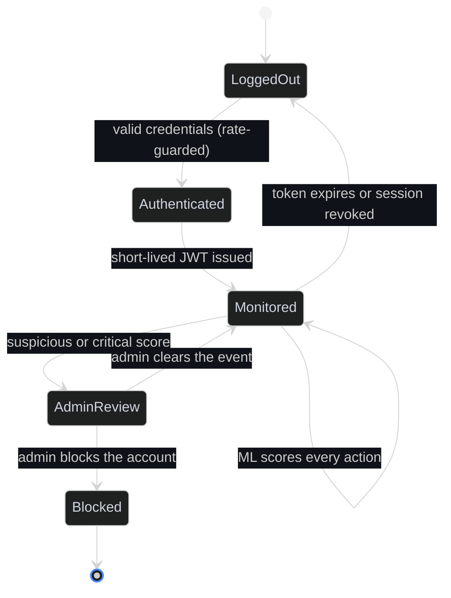
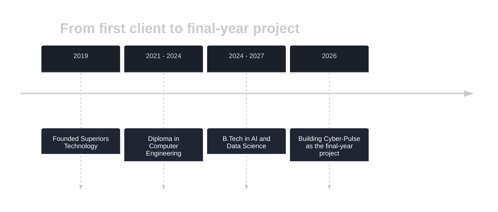

<div align="center">



<br/>


[](https://superiors.in)

</div>

## ~/skills

Where my skills sit across building, AI, security and business:



## ~/workflow

How an idea becomes a shipped product:



## ~/security-model

How a session lives and dies in [Cyber-Pulse](https://github.com/KLI888), my Zero Trust healthcare security project. The ML flags, a human decides:



## ~/journey



## ~/superiors

| Services | Industries served |
|---|---|
| Branding · Marketing · Content creation · IT services | Hospitality · Healthcare · Food and Beverage |

20+ clients since 2019 at [superiors.in](https://superiors.in).

## ~/now

| | |
|---|---|
| **Building** | Cyber-Pulse, an ML-driven Zero Trust security framework for healthcare |
| **Shipping** | AI automations for real businesses |
| **Learning** | Agents, local LLMs, security |

## ~/projects

<div align="center">

</div>

<!-- TODO: link each project's repo, e.g. https://github.com/KLI888/REPO -->

## ~/stats

<div align="center">


<br/>


<br/><br/>

<picture>
  <source media="(prefers-color-scheme: dark)" srcset="https://raw.githubusercontent.com/KLI888/KLI888/output/github-snake-dark.svg" />
  <source media="(prefers-color-scheme: light)" srcset="https://raw.githubusercontent.com/KLI888/KLI888/output/github-snake.svg" />
  
</picture>

</div>

## ~/contact

<div align="center">

[](https://superiors.in)
[](https://github.com/KLI888)
<!-- LinkedIn: [](YOUR_LINK) -->

</div>

```bash
┌──(kli888㉿kali)-[~]
└─$ echo S0xJODg4 | base64 -d
KLI888
```