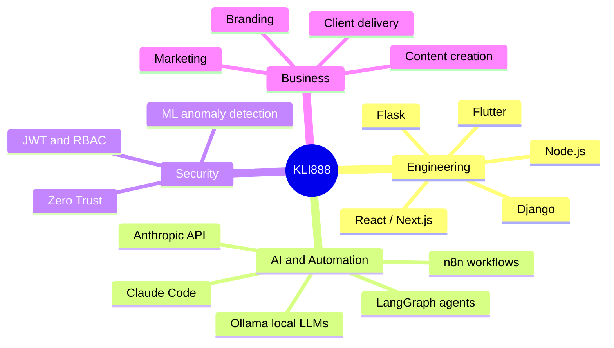
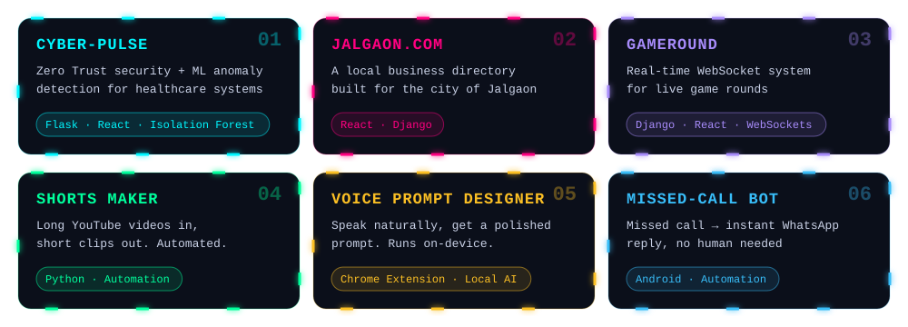
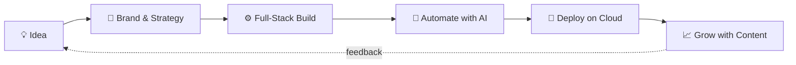

<div align="center">



<br/>


[](https://superiors.in)

<br/>



</div>

<br/>


Plenty of developers can build. Plenty of people can run branding and marketing. **Very few do both, run a real agency since 2019, and also ship AI and security systems.**




<div align="center">

</div>

<details>
<summary><b>🧰 Prefer the classic icon view?</b></summary>
<br/>

<p>

</p>
<p>


</p>
<p>

</p>

</details>


<div align="center">

</div>

<!-- TODO: link each project's repo, e.g. [Cyber-Pulse](https://github.com/KLI888/REPO) -->





<div align="center">


<br/>


<br/><br/>

<picture>
  <source media="(prefers-color-scheme: dark)" srcset="https://raw.githubusercontent.com/KLI888/KLI888/output/github-snake-dark.svg" />
  <source media="(prefers-color-scheme: light)" srcset="https://raw.githubusercontent.com/KLI888/KLI888/output/github-snake.svg" />
  
</picture>

<br/>


</div>


- 🏢 Building and running a tech and branding agency while still a student
- 🤖 Automating real business workflows with **n8n** and AI agents
- 🧠 Running **local LLMs** with Ollama, without sending data to the cloud
- 🛡️ Applying **Zero Trust** thinking to healthcare systems

<div align="center">

[](https://superiors.in)
[](https://github.com/KLI888)
<!-- LinkedIn: [](YOUR_LINK) -->

<br/>

<details>
<summary>🥚 <b>Easter egg</b> (only for people who scroll this far)</summary>
<br/>

Run this in your terminal:

```bash
echo S0xJODg4 | base64 -d
```

</details>


</div>
